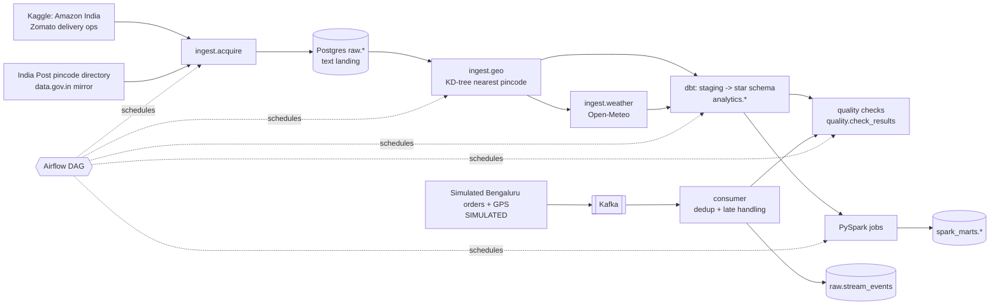

# India Last-Mile Data Platform

**An intra-city delivery data platform for Indian cities.** Messy real delivery records (Amazon India, Zomato) are
ingested, mapped to pincode / district / city with the India Post directory, enriched with historical weather,
modelled into a PostgreSQL star schema with dbt, checked by automated data-quality rules, and aggregated with
PySpark to answer logistics questions: *which pincodes are busy at which hour, how much does rain or a festival
slow a delivery, how busy are couriers, how do cities compare.* A simulated Bengaluru order stream (Kafka) adds the
live side of a Porter-style platform. Airflow schedules it all, one date partition per run.

> Status: private build. Headline numbers are in [`docs/RESULTS.md`](docs/RESULTS.md) (generated by the
> recorded run) and summarised under *Results* below.

## Architecture



## How to run

Native (what produced the recorded results; no Docker needed):
```bash
make setup           # venv, pinned deps, JDK + Kafka into .tools/ (needs: uv, ~/.kaggle/access_token)
make e2e             # starts services, runs everything, writes docs/RESULTS.md, stops services
make demo            # small-slice run (~70 s, 2,000 rows per source, 20k events; writes docs/RESULTS_SAMPLE.md) for a quick look
```
Docker (reviewer path; `docker-compose.yml`, **not executed by the author - Docker was unavailable on the build machine**):
```bash
make up              # Postgres, Airflow (LocalExecutor), Kafka (KRaft), Spark runner
```
Individual stages: `make acquire load geo dbt quality spark stream`; tests/lint: `make test lint`.
Kaggle credentials are read at runtime from `~/.kaggle/access_token` and never written into the repo, logs or images.

## Data sources

| Source | What | Rows | Licence |
|---|---|---|---|
| Kaggle `sujalsuthar/amazon-delivery-dataset` | Amazon India last-mile deliveries (coords, weather, traffic, vehicle, delivery minutes) | 43,739 | MIT |
| Kaggle `saurabhbadole/zomato-delivery-operations-analytics-dataset` | Zomato food-delivery ops (courier id, festival flag, multiple deliveries, delivery minutes) | 45,584 | "other" (not specified by uploader) |
| Kaggle `shibin007/all-india-pincode-directory2025` | Mirror of India Post "All India Pincode Directory" (data.gov.in) with office lat/long | 165,627 offices (19,460 pincodes usable) | CC-BY-SA-4.0 |
| Open-Meteo archive API | Daily temperature, rain, wind per city, 2022-02-11 to 2022-04-06 | 24 cities, 1,320 city-days | CC-BY 4.0, no key |

Raw files are gitignored; `ingest.acquire` is idempotent.

## Ingest results (real run)

* **178,646** pickup/drop coordinates enriched; **163,249 matched (91.38%)** to a pincode within 10 km
  (Amazon 91.5%, Zomato 91.3%). Mean distance to the matched pincode office ~1-3 km.
* The ~8.6% unmatched are mostly coordinates **outside India** (e.g. (0,0) and negative latitudes: ~7,800 pickup
  and ~7,100 drop points) - genuine source defects that the quality checks count rather than hide.
* 24 cities received weather; city labels come from the nearest pincode's district (e.g. Mumbai Suburban -> Mumbai).

## Results

From one recorded end-to-end run (`make e2e`, native, 344 s wall clock; full tables in
[`docs/RESULTS.md`](docs/RESULTS.md), all queried from the warehouse):

| Metric | Result |
|---|---|
| Delivery rows ingested | 43,739 Amazon India + 45,584 Zomato = **89,323** (plus 165,627 pincode offices, 1,320 weather city-days) |
| Pincode match rate | **91.38%** of 178,646 pickup/drop points within 10 km of an India Post pincode |
| Batch quality failures caught | 7,764 coordinates outside India, 8,238 unmatched-to-pincode, 5,890 unparseable timestamps; 0 duplicate order ids and 0 negative/absurd delivery times in the real data; **12,852 of 89,323 (14.4%)** rows flagged invalid in `fct_deliveries` |
| Streaming (simulated) | **1,000,000** events produced; 973,543 landed; caught 19,577 duplicates, 9,760 late GPS pings, 4,897 out-of-bounds GPS, 1,983 malformed (36,217 bad events) at ~7,400 events/s consumed |
| Runtime | ingest + geo ~16 s, dbt build 13 s (52 models/tests), Spark 32 s (four marts, 8,406 rows), streaming step 268 s |

Business findings (Zomato, valid rows; Spark marts):
* **Festival days add ~19.5 min** to a delivery (45.5 vs 26.0 min, 708 festival deliveries).
* **Traffic matters most**: "Jam" averages 31.2 min vs 21.3 min in low traffic (+9.9 min, +46%).
* **Rain barely moves the needle** in this data: heavy rain +2.3 min (only 58 deliveries), moderate none - an honest
  null result; the source's own weather label (cloudy/fog +7 min vs sunny) shows a larger effect.
* **Couriers are under-utilised**: mean utilisation (busy time / on-shift time) 34.6%, median 30.7%.
* **Amazon India deliveries are slow** (about 125 min average, ~94% over 45 min in every city) vs ~26 min for food delivery.
* Caveat: the Kaggle sets look partly synthetic (many deliveries snap to the same few pincodes, e.g. 453771 Indore peaks),
  so treat business findings as demonstrations of the pipeline, not market truths.

## What is real vs simulated

* **Real:** Amazon India and Zomato delivery records, the India Post pincode directory, Open-Meteo weather.
  All batch results (marts, quality counts, findings) come from these.
* **Simulated:** the Bengaluru order/GPS stream (`streaming/`). Its demand-by-hour and delivery-time distributions
  are parameterised from the real data, but every event is generated, and injected late/duplicate/out-of-bounds
  events are deliberate. It demonstrates the Kafka -> consumer -> quality path, not real Porter data.
* **Not included:** the live Delhi bus feed (Delhi Open Transit Data). It needs an API key; the project is complete
  without it and `streaming/` is the extension point.
* Dataset caveats: the Kaggle datasets are 2022 snapshots; Zomato's `City` column is an area type, so cities are
  derived from coordinates; courier utilisation is Zomato-only (Amazon has no courier id).

## Layout

`ingest/` acquisition, raw load, geo, weather · `warehouse/` dbt + quality checks · `spark/` PySpark jobs ·
`streaming/` Kafka simulator + consumer · `orchestration/` Airflow DAGs · `docs/` contracts, walkthrough, results.
See [`docs/CONTRACTS.md`](docs/CONTRACTS.md) for table-level interfaces and [`docs/WALKTHROUGH.md`](docs/WALKTHROUGH.md)
for a plain-English explanation and interview Q&A.
