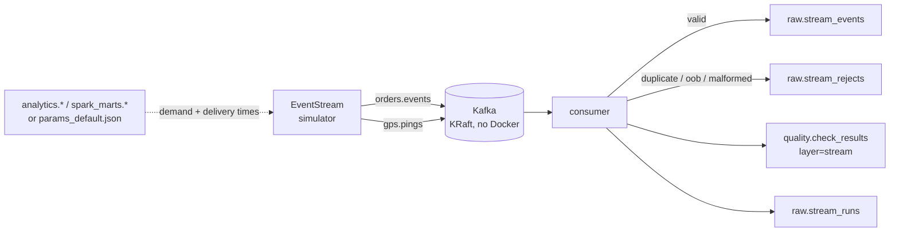

# Streaming: simulated Bengaluru order + GPS pipeline

Owner: `fm/ilm-stream-01` (dir `streaming/`). Contract: [`docs/CONTRACTS.md`](CONTRACTS.md) section 7.

This piece shows the **streaming half** of the platform: a Kafka producer that simulates a
Porter-style Bengaluru intra-city order lifecycle, and a consumer that validates, deduplicates
and lands those events into PostgreSQL while counting rejects. Nothing here is real traffic -
every payload carries `"simulated": true` - but the *shape* of the stream (which hours are busy,
how long a delivery takes under each traffic/weather condition) is parameterised from the
delivery data so the simulated load looks like the real one.

## 1. What it does, in one picture



* **Producer / simulator** (`streaming/simulator.py`, `streaming/producer.py`)
  * Emits five event types: `order_created` -> `driver_assigned` -> `picked_up` -> repeated
    `gps_ping` -> `delivered`, for `two_wheeler` and `truck`.
  * Orders start on a virtual clock whose rate follows the 24-hour demand curve; each order's
    timeline overlaps the next, so the generator merges all in-flight timelines with a min-heap
    and emits messages in **event-time order** (like a healthy stream). Only deliberate faults
    break that order.
  * Deliberately injects faults at configurable rates: **duplicates**, **late events**,
    **out-of-bounds GPS** and **malformed** payloads.
* **Topics**: `orders.events` (lifecycle) and `gps.pings`; key = `order_id` / `driver_id`; JSON
  value with `event_id, event_type, order_id, driver_id, vehicle_type, city, event_ts, lat, lon,
  speed_kmh` exactly as CONTRACTS section 7 requires.
* **Consumer** (`streaming/consumer.py` + `streaming/validation.py`) validates each message,
  keys dedup on `event_id`, tracks a watermark **per topic**, and lands good events; rejects go to
  `raw.stream_rejects` and per-check counts to `quality.check_results`.
* **Where the distributions come from** (`streaming/params.py`): `analytics.fct_deliveries` /
  `spark_marts.deliveries_per_pincode_hour` (hour-of-day demand) and
  `spark_marts.delay_impact` (delivery time by traffic) are used **if present**; otherwise the
  checked-in fallback `streaming/params_default.json`. On this branch the warehouse marts did not
  exist yet, so the recorded run used the JSON fallback (`demand=json delivery=json`); once the
  warehouse builds, the same command picks up the learned numbers with no code change.

## 2. How to run it (native, no Docker)

Docker is not installed on the build machine. Kafka runs from the native KRaft binary fetched by
`scripts/fetch_tools.sh` into `.tools/`, managed by `streaming/kafka_stream.sh`. To avoid clashing
with the batch lane on the shared machine, streaming uses its **own ports**:

| Service | Port |
|---|---|
| Kafka PLAINTEXT | `127.0.0.1:9094` |
| Kafka CONTROLLER | `127.0.0.1:9095` |
| PostgreSQL | `127.0.0.1:5436` (its own data dir `data/pg-stream`, not the batch `.pgdata`) |

```bash
make setup          # venv (once) + fetch JDK/Kafka into .tools/
make stream-up      # start isolated Kafka 9094 + Postgres 5436
make stream-test    # unit tests for validation/dedup/watermark (no Kafka)
make stream-million      # produce + consume ~1,000,000 simulated events
make stream-down    # stop both services when finished
```

Single run, explicit:

```bash
export KAFKA_BOOTSTRAP=127.0.0.1:9094 PGPORT=5436
python -m streaming.run --events 1000000 --json-out logs/stream_1m.json
```

`--partitions N` (default 1) and `--seed` (default 42) control the run; `--mode produce|consume`
can split the stages. `make stream` (the contract target) uses the default ports
`127.0.0.1:9092` and `5433`, which is what the integrated pipeline uses.

## 3. Recorded run (real numbers)

Clean native run on 2026-10-10, seed 42, 1 partition, allowed lateness 300 s, `load_id
20261010T123121`, Kafka `127.0.0.1:9094`, Postgres `5436`:

| Metric | Value |
|---|---|
| Events produced | **1,000,000** in **188.0 s** (5,318/s produce) |
| Events consumed | **1,000,000** in **146.2 s** end-to-end (**6,839 events/s**) |
| Landed in `raw.stream_events` | **973,753** |
| Duplicates dropped | **19,313** (1.93%; injected 2.0%) |
| Late events (`is_late=true`) | **9,661** (0.97%; injected 1.0%) |
| Out-of-bounds GPS rejected | **4,916** (0.49%; injected 0.5%) |
| Malformed rejected | **2,018** (0.20%; injected 0.2%) |
| GPS pings landed | 960,177 rows (98.6% of landings) |
| Orders started | 3,469 `order_created` (3,227 `delivered` after injects) |

Accounting check: `1,000,000 - 19,313 - 4,916 - 2,018 = 973,753` landed; every reject reason in the
run matches the configured injection rate, i.e. the consumer caught exactly the faults the
simulator planted and nothing else.

Rows written to `quality.check_results` (layer `stream`) for this run:

| check_name | dataset | rows_checked | rows_failed |
|---|---|---|---|
| `out_of_bounds_gps` | stream | 978,669 | 4,916 |
| `duplicate_event` | stream | 1,000,000 | 19,313 |
| `late_arriving_ping` | gps.pings | 960,177 | 9,661 |
| `malformed_event` | stream | 1,000,000 | 2,018 |

And one row in `raw.stream_runs` for the run (produced/consumed/landed/dups/late/oob/malformed,
duration, events/s).

Idempotency was checked directly against the database: re-inserting an existing `event_id`
(`BLR0000001:order_created:1`) left the row count unchanged (0 rows inserted) thanks to
`INSERT ... ON CONFLICT (event_id) DO NOTHING`.

To reproduce: `make stream-up && make stream-million`. The 1M figure is the number of **messages**
(lifecycle + GPS, duplicates included), not orders.

## 4. Design choices

* **Event-time ordering via a merge heap.** The simulator has many concurrent orders, so emitting
  one order fully before the next would make almost every event "late". Merging timelines with a
  min-heap makes the stream arrive in order, so lateness measures the *injected* late events, not
  an artefact of the generator.
* **Per-topic watermarks.** `orders.events` and `gps.pings` are independent topics; a single global
  watermark mis-flags events whenever the consumer interleaves the two. Each topic carries its own
  `max(event_ts)` watermark, and an event is late if it is older than `watermark - allowed_lateness`
  (300 s). Late events are **kept** and flagged `is_late=true`, not dropped, so the warehouse can
  still use them.
* **Idempotent upsert, not "exactly once".** Dedup is keyed on `event_id`: an in-memory set makes
  the *decision* fast, and the `raw.stream_events` primary key plus `ON CONFLICT DO NOTHING` makes
  the *write* idempotent across retries and re-runs. That is the practical at-least-once +
  idempotent-sink pattern Kafka gives without transactions.
* **One partition in the recorded run.** Kafka only guarantees order *within* a partition; with
  several partitions, cross-partition interleaving reorders the stream and inflates lateness. The
  recorded run uses one partition so the lateness number is honest. `--partitions N` scales out,
  at the cost of needing per-partition watermarks / a reorder buffer.
* **Rejects counted per reason.** `raw.stream_rejects.reason` is `duplicate|out_of_bounds|malformed`
  and the same counts feed `quality.check_results`, so "how many bad rows did we catch" is a query,
  not a log line.
* **Runs anywhere.** Everything reads the contract env vars (`KAFKA_BOOTSTRAP`, `PG*`); the isolated
  ports live only in the make targets/scripts, not in the code.

## 5. Files

| File | Purpose |
|---|---|
| `streaming/params_default.json` | fallback demand curve + delivery-time distribution |
| `streaming/params.py` | load params, preferring warehouse-derived distributions |
| `streaming/simulator.py` | deterministic event-time-ordered order/GPS generator + fault injection |
| `streaming/validation.py` | pure validation / dedup / per-topic watermark (Kafka-free) |
| `streaming/producer.py` | Kafka topic management + producer |
| `streaming/consumer.py` | Kafka consumer wiring processor to the sink |
| `streaming/db.py` | Postgres landing, rejects, run summary, quality rows |
| `streaming/sql/stream_ddl.sql` | streaming tables (copy of `ingest/sql/ddl.sql`) |
| `streaming/kafka_stream.sh` | native KRaft Kafka on 9094/9095 |
| `streaming/native_pg.sh` | isolated native Postgres on 5436 |
| `streaming/run.py` | CLI entry point (`python -m streaming.run --events N`) |
| `tests/streaming/` | unit tests, no Kafka/DB needed |

## 6. Likely interview questions

**Q: Why Kafka here, and how do you run it with no Docker?**
A: The JD asks for Kafka, so the streaming path is genuinely Kafka, not a fake in-process queue.
On this machine there is no Docker and no sudo, so we run a single-node **KRaft** broker from the
native Apache Kafka binary (`.tools/kafka`), started by `streaming/kafka_stream.sh` via a make
target. KRaft means no ZooKeeper, and the same topics/consumer code would run unchanged against a
managed broker - only `KAFKA_BOOTSTRAP` changes.

**Q: How do you stop duplicate events from landing twice?**
A: Every event carries a stable `event_id`. The consumer keeps an in-memory set to decide
duplicate vs first-copy quickly, and the database write is
`INSERT ... ON CONFLICT (event_id) DO NOTHING` against a primary key. So retries or re-runs can
replay the same messages and the table still holds exactly one row per event - at-least-once
delivery plus an idempotent sink, which is what Kafka gives without transactions.

**Q: How do you handle late-arriving data?**
A: We track a watermark per topic (the maximum `event_ts` seen so far) and allow 300 s of
lateness. An event older than `watermark - 300 s` is still **landed**, but flagged `is_late=true`;
the `late_arriving_ping` quality check counts them. Dropping them would lose data and silently
bias the warehouse, and using a single global watermark across two topics would mis-flag the
interleaving, which we found and fixed.

**Q: Why did the recorded run use one partition? Doesn't that limit throughput?**
A: Kafka guarantees ordering only within a partition. Because we produce in event-time order, more
partitions mean the consumer interleaves them and the lateness metric stops meaning anything
(it jumped from ~1% to ~78% in testing). One partition keeps the recorded lateness honest. For
scale we would either key by order so each order is self-ordered and compute per-partition
watermarks, or add a small event-time reorder buffer in the consumer; the producer already
supports `--partitions N`.

**Q: How do you know the consumer actually caught the bad rows?**
A: The simulator injects faults at known rates and the consumer records rejects by reason. In the
recorded 1M run: 19,313 duplicates vs 2.0% injected, 9,661 late vs 1.0%, 4,916 out-of-bounds vs
0.5%, 2,018 malformed vs 0.2% - and `1,000,000 - 19,313 - 4,916 - 2,018 = 973,753` matches the
landed count exactly. Every reject is also written to `raw.stream_rejects` and summarised in
`quality.check_results`, so the claim is reproducible with a SQL query.

**Q: Are these real deliveries?**
A: No, and the payload says so (`"simulated": true`). Only Bengaluru orders are simulated. The
*distributions* are anchored to the real Amazon India / Zomato data: `streaming/params.py` reads
the hour-of-day demand curve and the per-traffic delivery times from the dbt/Spark marts when they
exist, and falls back to a checked-in JSON otherwise. That keeps the simulated load realistic
without ever presenting it as real.

**Q: What would you change for production?**
A: Use Confluent Schema Registry / Protobuf instead of ad-hoc JSON to version the contract; enable
compression and tune partitions with per-partition watermarks; write the dedup set to a compacted
topic or Redis so it survives restarts; use Kafka transactions or a checkpointed offset commit for
exactly-once into Postgres; and emit consumer-lag metrics to monitor the pipeline.
